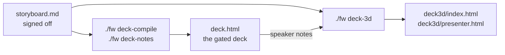

# deck-3d — a derived 3D View

A talk is planned once (deck-plan: Model → `points.md` → signed-off
`storyboard.md`) and rendered by Views. This skill adds one more View. It
plans nothing and owns no content: `./fw deck-3d` reads the storyboard rows
and the speaker notes already assembled in `deck.html`, and writes
`<talk>/deck3d/`.



## Use

```bash
./fw deck-compile <talk>     # deck.html from the storyboard
./fw deck-notes <talk>       # speaker notes into deck.html
./fw deck-3d <talk>          # deck3d/ from the storyboard and those notes
```

Open `<talk>/deck3d/index.html` in a browser. It has no build step and no
network dependency; the font is read from `<talk>/asset/`.

| Key | Action |
| :--- | :--- |
| click, `→`, space | next stop on the route |
| `←` | previous stop |
| `Esc` | the overview map; `→` returns to the stop it was opened from |
| click on the overview map | fly to that scene, island title or the cover, and continue the route from there |
| `1`–`9` | jump to that island's title |
| `F` | fullscreen |

The **overview** is also the last stop on the route. It is a flat map, not a
view of the sphere: the deck title on top, each island's name above a grid of
its scenes in reading order, every scene as a tile with its row number and
title. The tile of the stop it was opened from is filled in. The map picks the
number of rows that lets it fill the screen, so a long talk gets smaller tiles
on one screen and never a second page.

`presenter.html` is the presenter window: the current scene, the next stop and
the speaker note, driving the audience window it opens.

## What a row becomes

- The first `L-HERO-TITLE` row is the cover. Each later one opens an
  **island**; the rows after it are that island's scenes. Rows before the
  first section row form an island without a title stop.
- A row whose items each carry a heading and a body **unfolds**: one overview
  scene with the headings, one scene per item, one for the closing line. The
  flight between scenes is what this View is for, and a dense panel is
  unreadable at the distance the camera stops, so density is traded for
  stops. Every scene of a row carries that row's speaker note.
- A two-camp row (`L-VS-CONFRONT`) is one side-by-side scene.
- A scene that still does not fit is split further in the browser, at
  sentence boundaries, marked `（1/2）`.
- A drawing (`L-CANVAS` flow charts and SVG) is not carried:
  the command prints a warning naming the row, and the drawing stays in
  `deck.html`.

## Rules

- **Never edit anything in `deck3d/`.** It is regenerated in full; a wording
  change goes to `storyboard.md` (then deck-compile, deck-notes, deck-3d), a
  fact to the Model first (deck-plan § Changing a planned talk). A hand edit
  would be lost on the next run and would let the two Views disagree.
- **`deck.html` stays the deck.** `./fw build`, the density gate and the
  slide verification read `deck.html`; `deck3d/` is excluded from the prose
  checks as a derived directory. Sign-off, citations and speaker notes are
  settled there before this View is generated.
- **Run the self-check after generating.** Open `index.html#debug` (headless
  is fine, see the browser-automation skill your host provides) and read two
  attributes on `<body>`: `data-minfont="ok"` means every scene's text is at
  least 30px on a 1280×720 frame when the camera arrives, `data-overflow="none"`
  that no line leaves its panel. A failure names the scene; shorten that row in
  the storyboard rather than patching the output.
- **It keeps its own dark palette and presenter**, not the house-style light
  theme or `deck-stage`: scenes float in an unlit space where a light panel
  glares, and the route is a path through a world, not a page index
  (`docs/DESIGN.md`, the 2026-11-10 decision on derived Views).

## Files

| File | Role |
| :--- | :--- |
| `template/engine.js` | camera, panels, text layout, presenter remote, `#debug` self-check; carries no talk |
| `template/world.js` | lays out the generated `DECK` on the sphere, splits scenes that do not fit, builds the route |
| `template/host.html` | the page; `./fw deck-3d` fills in the title and `DECK` |
| `template/presenter.html` | presenter window |
