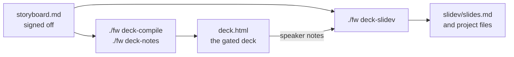

# deck-slidev — a derived Slidev View

A talk is planned once (deck-plan: Model → `points.md` → signed-off
`storyboard.md`) and rendered by Views. This skill adds one more View. It
plans nothing and owns no content: `./fw deck-slidev` reads the storyboard
rows and the speaker notes already assembled in `deck.html`, and writes
`<talk>/slidev/`.



## Use

```bash
./fw deck-compile <talk>     # deck.html from the storyboard
./fw deck-notes <talk>       # speaker notes into deck.html
./fw deck-slidev <talk>      # slidev/ from the storyboard and those notes

cd <talk>/slidev
pnpm install                 # once; the command above installs nothing
pnpm dev                     # present in the browser, presenter mode included
pnpm exec slidev export slides.md --format png --executable-path <chromium>
```

- Use the JavaScript package manager the course or machine prescribes; the
  generated `pnpm-workspace.yaml` settles pnpm's build-script question
  (esbuild allowed, the Playwright browser download declined), because an
  undecided build script makes `pnpm install` fail.
- Export drives a Chromium. Pass one with `--executable-path`, or download
  Playwright's once with `pnpm exec playwright install chromium`.

## What a row becomes

One storyboard row is one slide, on a layout of Slidev's default theme:

| Row | Slidev layout |
| :--- | :--- |
| first `L-HERO-TITLE` | `cover` |
| later `L-HERO-TITLE` | `section` |
| a quotation (`L-QUOTE-CRITIQUE`) | `quote` |
| a key figure (`L-STAT-HERO`), or a defined term of at most 8 characters (`L-DEFN-EXAMPLE`) | `fact` |
| a longer defined term | `default`, the term as the heading: `fact` prints its heading several times the body size, and three lines of it push the definition off the slide |
| two camps (`L-VS-CONFRONT`) | `default`, two columns |
| everything else | `default`: title, lead, a list, the closing line as a blockquote |

- A row whose 動態 has `M-STEP` reveals its list with Slidev's click steps
  (`<v-clicks>`); the other motion codes belong to deck-svg's lively mode and
  are not translated.
- The row's speaker note becomes the slide's presenter note.
- Slot text is escaped so it prints as written: Markdown, Vue's `{{ }}` and
  Slidev's typographer would otherwise turn a stray `*`, `{{x}}` or `--` into
  formatting.
- A drawing (`L-CANVAS` flow charts and SVG) is not carried:
  the command prints a warning naming the row, and the drawing stays in
  `deck.html`.
- The house font is copied to `slidev/public/`. It has one weight, so
  emphasis is a colour, not a synthesized bold.

## Rules

- **Never edit `slides.md` or the generated project files.** They are
  regenerated in full; a wording change goes to `storyboard.md` (then
  deck-compile, deck-notes, deck-slidev), a fact to the Model first
  (deck-plan § Changing a planned talk). A hand edit would be lost on the
  next run and would let the two Views disagree.
- **`deck.html` stays the deck.** `./fw build`, the density gate and the
  slide verification read `deck.html`; `slidev/` and its `node_modules/` are
  excluded from the prose checks as derived directories. Sign-off, citations
  and speaker notes are settled there before this View is generated.
- **Look at the export before presenting.** Nothing measures a Slidev slide
  for overflow: export PNGs and read each one. A slide that overflows is a
  row to shorten in the storyboard.
- **Installed packages stay out of git.** The generated `.gitignore` covers
  `node_modules/`, the copied font and exports, because they are large and
  reproducible; `slides.md` and the small project files are regenerated
  identically from the storyboard.
