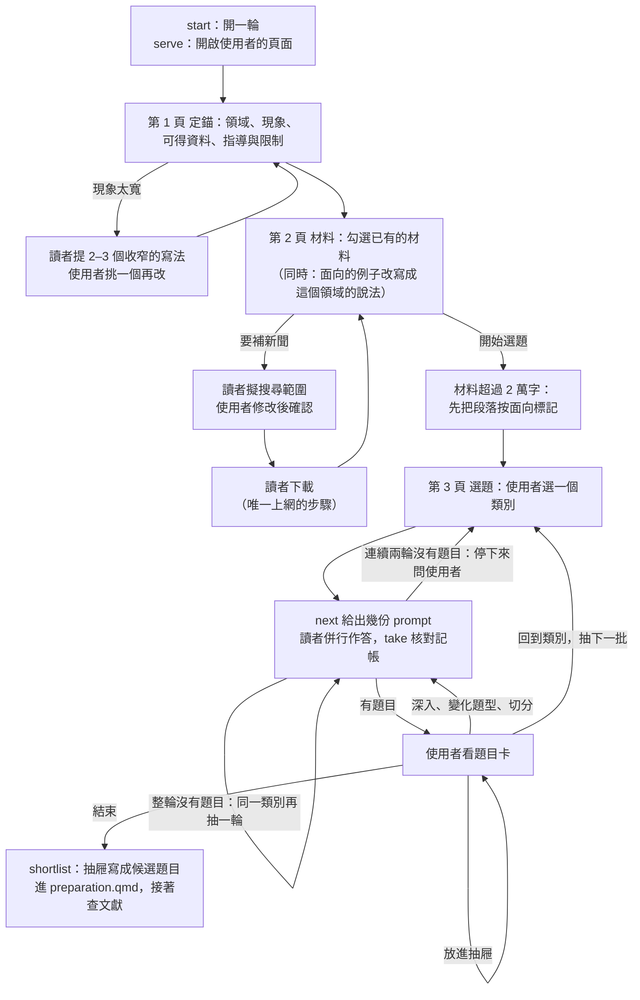

# 規則窮舉選題法（`/topic_enumerate`）

`/topic_discovery` 讓 AI 自由讀材料找矛盾，速度快，但每次都會收斂到同樣幾個顯而易見的
題目。這裡把「要檢查哪些組合」交給程式，AI 只判斷每一組在這個現象上是不是真的矛盾，
使用者在一個本機網頁上決定往哪裡找、留下哪些。使用者的興趣從第一題就進來，因為這個
題目要做一兩年，而興趣是任何評分都抓不到的。

## 整體流程



## 39 個面向與 741 組配對

TRIZ 矛盾矩陣的 39 個工程參數，各對應一個社會科學面向：「移動物體」讀成行動者與
流動，「靜止物體」讀成結構與制度。面向分成五個類別（規模與範圍；權力、秩序與變遷；
資源與成本；信任與風險；治理與制度設計）。對應表只有一份，在
[`../assets/triz-parameters.json`](../assets/triz-parameters.json)，用
`./fw topic-enumerate params` 列出。這份對應是初稿，不是 TRIZ 文獻的標準譯法；換到別的
學門前，先請使用者看過一次，因為之後所有題目都從這張表長出來。

39 個面向兩兩配對共 741 組，`start` 時洗牌一次，順序連同種子記在這一輪的記帳檔裡。
洗牌是為了不讓每次都從同一個類別開始；記帳是為了看過的配對不會重問，想把 741 組
全部看完也隨時可以接著做。

TRIZ 找到矛盾是為了消除它；論文找到矛盾，矛盾本身就是研究對象。所以矛盾矩陣每一格
推薦的發明原則不使用，那些推薦是從專利統計出來的，面向換成類比之後沒有實證基礎。

## 三個頁面

`./fw topic-enumerate start <unit>` 開一輪並列出課程裡已有的材料，`serve` 開啟頁面。
之後使用者在頁面上依序走三頁，agent 只負責執行頁面交給它的工作。

1. **定錨。** 四個欄位：領域、現象、可得資料、指導與限制，送出後寫成
   `<unit>/topic-enum/anchor.md`。「領域」預設取自課程的 `COURSE.md`。「領域」與「現象」
   會原文放進每一份 prompt，所以要寫到不認識這個題目的人也看得懂；後兩項不給讀者看，
   因為讀者看到了會自己先猜哪些題目做不出來。
   - 現象寫成一個領域（「某場戰爭、某組織的動向」）時，題目會跟著空泛。使用者按
     「請 AI 提幾個更具體的寫法」，agent 收到一份 `sharpen` 工作，讀者提出 2 到 3 個
     切入點不同的寫法；使用者挑一個放進欄位再改。讀者不上網，需要使用者補的事實用
     〔〕標出，有〔〕的定錨送不出去，這樣讀者編不了事件，使用者也不會漏補。
   - 定錨送出時，agent 會收到一份 `localize` 工作：把 39 個面向的例子改寫成這個領域的
     說法（面向名稱不動）。對應表的通用例子偏公共行政，換到別的領域時讀者會看不出
     面向在指什麼。改寫好的例子列在材料頁下方，請使用者看一眼；`start --stock-examples`
     可以關掉這一步。
1. **材料。** 列出 `<unit>/topic-enum/materials/` 裡的 `.md`、`.txt`（或 `start` 時用
   `--materials 'refs/*.md'` 指到的既有來源；已經在 `refs/` 的不要複製，一份來源只有
   一個家）。使用者勾選要用哪些（可全選、全不選），頁面顯示總字數。要補新聞時：
   - 使用者按「請 AI 擬搜尋範圍」，agent 收到一份 `scope` 工作，擬出搜尋詞、時間範圍
     與來源。下載了什麼就決定會長出什麼題目，所以範圍由使用者修改後確認。
   - 使用者按「照這個範圍下載」，agent 收到一份 `collect` 工作。這是整個流程唯一上網
     的工作，要交給能上網的讀者。每篇存成一個檔案，只照原文抄錄相關段落；抓不到的
     列在頁面上，不能默默跳過，因為缺了哪些會影響結果。
1. **選題。** 使用者按「開始選題」後，材料切成有編號的段落（`M03-P002`），定錨與材料
   就此固定。之後要改，用 `--run r2` 另開一輪，這樣答案永遠只會對照它當初拿到的文字。
   - 段落總長超過 2 萬字（`start --index-over` 可改）時，agent 先收到幾份 `index` 工作：
     讀者把每一段標上它談到的面向，每段最多 4 個。標完之後，每份 prompt 只帶談到它那
     幾組面向的段落，讀者不必每次讀完全部材料；任一面向沒有段落的配對直接記為
     「材料未涵蓋」，不派讀者；頁面列出每個面向有幾段，使用者在花錢之前就看得到材料
     沒談到哪些方向。標記完成前不能選類別。
   - 這是用召回率換成本：一段若只順帶提到某個面向，可能沒被標上，那個面向的配對就少
     一段依據。材料不到 2 萬字時不標記，每份 prompt 帶全部段落。

不用頁面時，同樣的動作可以用 `./fw topic-enumerate choose <unit> <action>` 做：
`init` 寫出 `anchor.md` 的骨架讓人填，`choose anchor` 讀回，`choose begin` 開始選題。

## 互動迴圈

先在背景啟動頁面，把網址交給使用者：

```bash
./fw topic-enumerate serve <unit>     # http://127.0.0.1:8741/，只聽本機，要一直開著
```

使用者每按一個按鈕，程式就寫好對應的 prompt。按鈕之間不互相等待，所以使用者可以連續
按好幾個，agent 把它們併行派出去：

```bash
./fw topic-enumerate next <unit>      # 印出所有待派的 prompt，每份三行：task、prompt、answer
# 每份 prompt 各交給一位讀者，同時進行；讀者把答案寫到 answer 那個路徑
./fw topic-enumerate take <unit>      # 核對已經回來的答案並記帳，還沒回來的不受影響
```

- 能在背景執行指令的 agent 同時維持兩件事：一個 `next` 在背景等使用者按鈕，一有新的
  prompt 就派出去並重新啟動 `next`；任何一位讀者回來就執行一次 `take`。這樣使用者按鈕
  後不必等前一批做完。不能併行的 agent 依序做 `next`、逐份作答、`take` 也可以，只是慢。
- `next` 結束碼 0 表示有 prompt 要派；3 表示等了一段時間沒有新的，再執行一次即可；5
  表示使用者按了結束。`next --resend` 會把已經派出但還沒回來的也印出來，用在 agent
  中斷後接手。
- `next` 印出 `stop: T004 T005` 時，表示使用者在頁面上取消了這幾份：把還在做它們的讀者
  停掉。被取消的工作即使有答案回來，`take` 也不會收。
- 頁面靠 `next` 知道 agent 還在：`next` 等待時會持續留下記號，超過 30 秒沒有記號，頁面
  就顯示「agent 沒有在接手」。所以派完讀者要馬上重新啟動 `next`，否則使用者按了按鈕卻
  沒有人處理。
- `take` 退回時（少回一組、多回一組、引用了材料裡沒有的段落編號、沒有題目卻沒有理由）
  會印出要重派的 prompt 路徑，把同一份再派一次。不要手改答案檔，因為那等於繞過核對。
- 一輪抽出的 prompt 全部回來而且都沒有題目時，`take` 會自動再抽一輪，下一次 `next`
  就會拿到。連續兩輪（`start --dry` 可改）都沒有題目就不再抽，頁面告訴使用者這幾輪各有
  幾組「材料無依據」、幾組「無矛盾」，由使用者決定換類別還是再試：材料和現象對不上時，
  自動重抽只會一直花錢。
- 使用者也可以直接在對話裡說要做什麼，這時用
  `./fw topic-enumerate choose <unit> <action> [<topic>]` 代按，效果和頁面按鈕相同。

### 派發規則

1. **一份 prompt 一位讀者，讀者只拿到那份 prompt。** 派發時只說「讀這個檔案並照做」，
   不要補充背景，不要提 TRIZ、類別或後續流程。對找題目沒有幫助的資訊只會佔掉讀者的
   注意力。
1. **`collect` 交給能上網的讀者，其他工作（`scope`、`sharpen`、`localize`、`index` 與
   找題目）的讀者不上網。** 找題目的讀者只看同一批材料，題目才追溯得到出處。
1. **讀者要有獨立的 context。** 沒有 subagent 的 agent 可以自己讀，但同一個 context
   連讀多份時後面的判斷會受前面影響，要告訴使用者這一輪不是獨立讀者做的。
1. **讀者自己把答案寫進指定的檔案**，答案不要回傳到派發者的對話裡。prompt 裡的答案路徑
   是絕對路徑，因為試用時有讀者拿自己的工作目錄去接相對路徑，把答案寫進了別的 repo。
   所以還沒回來的 prompt 只能在寫出它的那台機器上作答；換機器後先按「取消進行中的」
   再重按。
1. **讀者用判斷力好的模型。** 同一組配對的對照試驗中，最便宜的模型多寫了近一倍的
   題目，多出來的是同義反覆（把同一件事的兩種說法當成矛盾）和硬套。這裡沒有後續的
   自動篩選，寫出來的每一題都會直接佔用使用者的時間，所以省下的費用不划算。
1. **不要代替讀者判斷。** 派發者不補寫、不刪題、不評分。

## 使用者在頁面上能做什麼

| 按鈕 | 結果 |
| :--- | :--- |
| 五個類別、全部隨機 | 從那個類別還沒看過的配對裡抽一輪（預設 4 份 prompt，各 5 組，併行）。整輪沒有題目就再抽一輪，直到出現題目。類別列固定在頁面最上方，不論深入到哪裡都能一步回到這一層 |
| 放進抽屜、拿掉 | 收集候選題目。抽屜從右側拉開，隨時可以放或拿，不會打斷正在進行的搜尋 |
| 深入：某個面向 | 固定題目的那個面向，配上它還沒看過的其他面向（預設一次 10 組，分成 2 份 prompt），可以重複按 |
| 變化題型 | 同一個矛盾，換成另外三種題型各問一次，每個題目一次 |
| 切分 | 同一個矛盾，依時間、場域、對象、層級各切出範圍更窄的題目，每個題目一次 |
| 取消進行中的 | 收回所有還沒回來的工作：它們的配對回到「還沒看過」，變化題型與切分可以再按一次。按錯類別，或發現材料不對時用 |
| 結束 | 關閉這一輪，還沒回來的答案不再處理；`./fw topic-enumerate shortlist <unit>` 把抽屜輸出成候選題目 |

四種題型把同一個矛盾變成不同的研究問題：

| 題型 | 問的問題 |
| :--- | :--- |
| 描述 | 這個取捨真的存在嗎？有多大？ |
| 解釋 | 為什麼改善一方會惡化另一方？機制是什麼？ |
| 條件 | 在什麼時間、場域、對象或層級下，這個取捨會消失或減弱？ |
| 評估 | 某個宣稱兩者兼得的做法，真的做到了嗎？ |

「切分」借用 TRIZ 的分離原則，對應到研究設計就是調節變項與邊界條件。

同時進行的 prompt 有上限（預設 12 份），超過時頁面會請使用者等一下，這是為了不讓連按
造成費用失控。

讀者對每一組配對回零到多個題目，或一個沒有題目的理由：**無矛盾**，或**材料無依據**。
頁面上每個類別會顯示已看過幾組；某個類別一直回「材料無依據」，表示材料沒有涵蓋那個
方向，要補材料就另開一輪。

## 接到選題決策包與論文的開頭

抽屜裡的題目只確認了一件事：材料裡看得到這個矛盾。文獻上新不新、資料拿不拿得到，
都還沒查。`./fw topic-enumerate shortlist <unit>` 把抽屜印成 **topic-scout** Phase 1 的
格式，agent 把它貼進 `preparation.qmd` 的「候選題目」，替每一題補上暫定題名，再照
[methodology.md § 題目評估矩陣](methodology.md#題目評估矩陣) 走 Phase 2 到 5。

題目卡上的每個欄位，在選題決策包和之後的論文（或研究計畫書）開頭各有去處：

| 題目卡上的 | 在選題決策包（`preparation.qmd`） | 在論文或計畫書的開頭 |
| :--- | :--- | :--- |
| 核心矛盾、觸發材料 | 候選題目的初步重要性 | 「研究背景與動機」：先寫現象裡「改善這個、那個就變糟」的事實，這就是 puzzle |
| 研究問題、題型 | 核心問題 | 「研究目的與問題」。題型決定研究設計的方向：描述偏測量，解釋偏機制，條件偏比較，評估偏政策評估 |
| 同一個矛盾的其他問法 | — | 子問題。同一個矛盾的描述、解釋、條件、評估四種問法，可以排成由淺到深的子問題；不打算處理的寫進研究限制 |
| 對象與場域、切分 | 範圍界定 | 「研究範圍與限制」 |
| 需要的資料，對照使用者的「可得資料」 | 可行性 | 研究方法裡的資料來源 |
| 矛盾的兩個面向 | 搜尋策略的「概念」列 | 文獻回顧的兩條文獻線，加上討論兩者關係的那一條 |
| 「指導與限制」 | 範圍控制 | 篇幅與時程 |

三件事要在轉手時守住：

1. **面向的名稱不是學術概念。** 「行動者的負擔」「可預測性與信任」是為了有系統地找
   矛盾而設的通用說法。寫進論文前，先在 Phase 2 把它們對應到這個領域的既有概念（例如
   同盟負擔分擔、嚇阻可信度），並且不要把 TRIZ 當成理論架構引用，因為對應表只是類比。
1. **觸發材料不是證據。** 新聞只用來指出問題；要在「研究背景與動機」引用時，照
   **source-kit** 取得原文、存進 `refs/`、建書目。`shortlist` 會印出每一段的出處與網址。
1. **「有矛盾」不等於「有缺口」。** 矛盾越明顯，越可能已經有人研究。Phase 3、4 查到
   文獻已經回答時，往「條件」題型或更窄的切分移動，通常比放棄整個矛盾好。

## 還沒做的部分

- 矛盾配對以外的抽法：九宮格（系統層級 × 時間）、進化趨勢、因果鏈、功能導向搜尋。
- 把共用面向的配對排進同一份 prompt。現在照洗牌順序分批，一份 prompt 的五組配對最多
  牽涉十個面向，帶的段落仍然不少。
- 抽屜裡的題目多到需要整理時的去重與排序。
