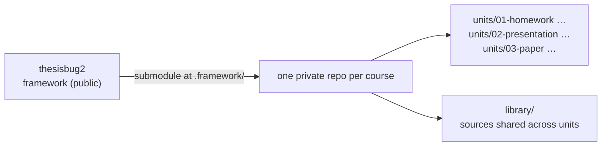
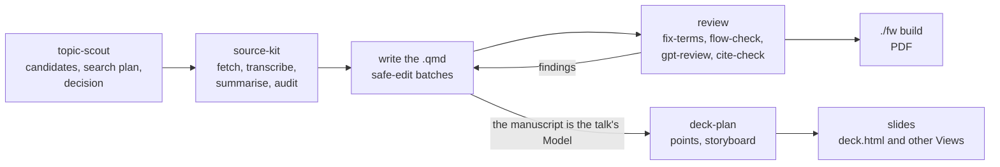
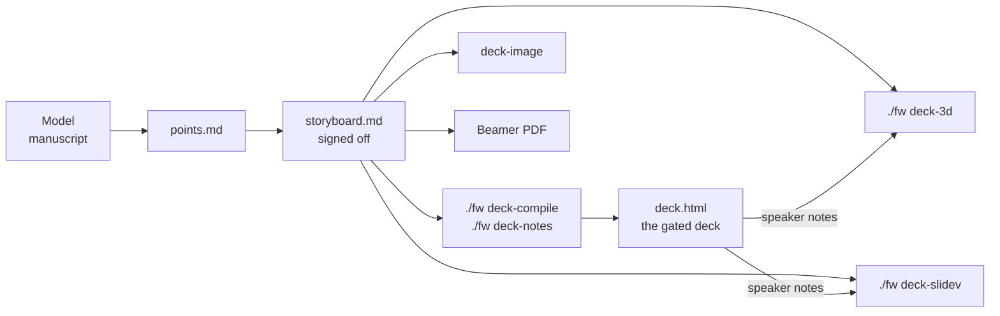
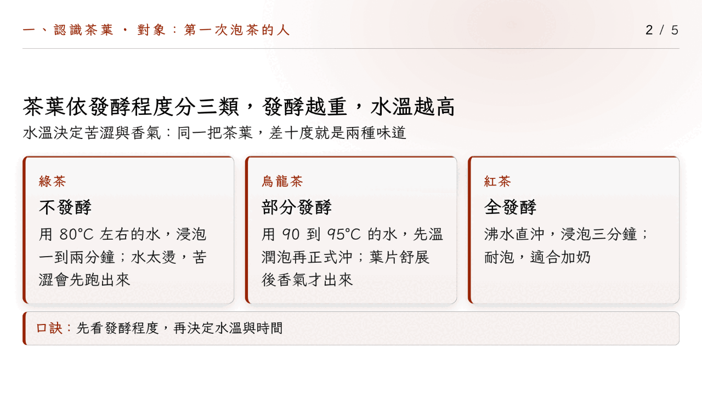
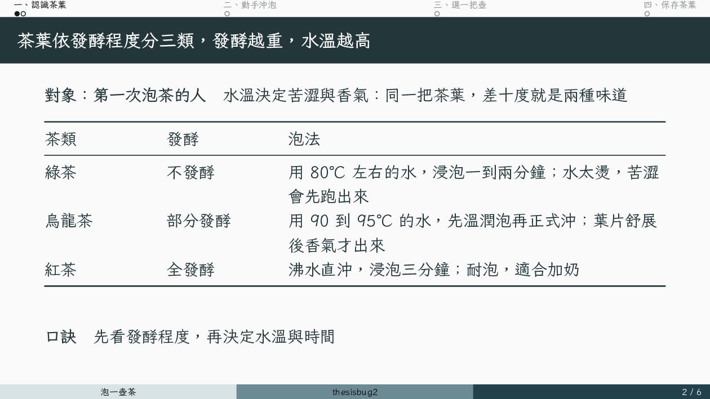

# thesisbug2

AI-agent framework for Traditional Chinese academic coursework — one repo per course, shared skills, audited sources, and slides planned from the paper.

> **Status: in use.** It has been used in formal university coursework since March 2026: the private first-generation template until September 2026, and this repository, the second generation, since then. The architecture in [`docs/DESIGN.md`](docs/DESIGN.md) is settled, 18 shared agent skills are in `.agents/skills/`, and `scripts/` has the `fw` dispatcher, `unit-init`, `build`, and the checking gates, with the Quarto templates in `assets/templates/`. Optional capabilities such as image generation and external review depend on the tools available to the agent. The [roadmap](#history-and-roadmap) shows what exists.

## Quick start

On macOS or Linux, with an AI coding agent already installed:

1. Install the tools in [Requirements](#requirements) and run `gh auth login`.
1. Create a course: `bash <(curl -fsSL https://raw.githubusercontent.com/enstw/thesisbug2/main/install.sh)`. It asks for the course name and a slug, and ends by printing `done — <path>`.
1. `cd` into the path it printed.
1. Start your agent there and tell it what you need, for example "this is the syllabus, fill in COURSE.md" or "start a paper unit on …". It reads `AGENTS.md` first and follows the framework from there.
1. Or start a unit yourself: `./fw unit-init --type paper --name final --title "…"`, which also builds the first PDF.

[Install](#install) has the details, the options, and what to do when a step fails.

## What it is

thesisbug2 is the working environment an AI coding agent (Claude Code, Codex, Antigravity) needs to help write graded academic work in Traditional Chinese. It is a set of files an agent reads and commands it runs, not an application: Quarto/XeLaTeX templates, agent skills written as plain `SKILL.md` procedures, and Python gates behind one dispatcher, `./fw`.

It works with an agent that can read files and run shell commands in a git repository. A chat window cannot use it, because the framework's guarantees come from files the agent must open and checks that must pass, not from what a model remembers.

## What it solves

| Problem when writing with AI | What the framework does about it |
| :--- | :--- |
| **Layout eats the time.** Cover page, table of contents, citation style, Chinese and Western references in separate groups, CJK fonts. | The manuscript is Markdown (`.qmd`). `./fw build` turns it into the PDF through Quarto and XeLaTeX with a template per work type (homework, paper, journal article, thesis) and a bundled font. Nobody formats a reference by hand. |
| **The model invents references.** A fluent citation to a paper that does not exist, or a real paper that does not say what the sentence claims. | A citation must resolve to an entry in `references.bib` with a local full text. The agent records two judgments per source in an append-only log: is this file the cited work itself, and does it back the claim. Page locators are checked against page markers in the transcript. [Details below](#sources-and-citations). |
| **Slides drift from the paper.** A deck written separately says things the paper does not. | A talk is planned from the manuscript: points, then a storyboard the author signs off, then slides. Every slide traces back to a cited sentence. [Details below](#slides-one-storyboard-several-views). |
| **Mainland usage and Simplified characters creep in.** | `fix-terms` proposes Taiwan academic terms; `./fw check-zh-variants` finds Simplified and variant code points in the source files. |
| **An agent's large edit breaks something quietly.** | `safe-edit`: every batch is a list of exact-match replacements that either all apply or none do, followed by the readability, variant, length and citation gates. |
| **One model has blind spots it repeats.** | `gpt-review` sends the chapter to a different model family as an anonymous referee; `flow-check` has a reader with no context mark where the argument jumps. |
| **Work moves between machines and agents.** | Everything durable is a file in git: course context, unit progress, decisions with their reasons. No agent's private memory is relied on. |

## How a course is organised

thesisbug2 is the second generation of a private template that modelled each piece of coursework as a git branch of the template itself. That design meant cherry-picking every framework fix into every live branch, left successive assignments of one course unrelated to each other, and mixed framework files with coursework. thesisbug2 splits the two:



- **The framework is this repository.** A course mounts it as a git submodule at `.framework/`. Updating is a pull; coursework never writes into it, so an update cannot conflict with your writing.
- **One repository per course.** Every assignment is a *unit* directory under `units/`. Units of the same course share a source `library/`, so a source fetched and audited for the midterm is ready for the final.
- **The framework version is pinned per course.** A unit handed in last semester still rebuilds to the same PDF.

```
<course>/
├── AGENTS.md          # course context; points at .framework/docs/AGENT-GUIDE.md
├── COURSE.md          # instructor, citation style, requirements, schedule
├── STATUS.md          # one line per unit
├── .framework/        # this repository, as a submodule
├── library/           # references.bib + refs/ shared by two or more units
├── notes/             # lecture notes, transcripts
└── units/
    ├── 01-homework-<topic>/
    ├── 02-presentation-<topic>/
    └── 03-paper-<topic>/      # WORK.json, PROGRESS.md, paper.qmd, references.bib, refs/, talks/
```

A new source lands in the unit that fetched it. When a second unit wants to cite it, `./fw refs promote <key>` moves it, with its audit history, into `library/`. The full rules are in [`docs/DESIGN.md`](docs/DESIGN.md) § Sources.

## From topic to PDF



The author decides; the agent drafts, fetches and checks. Topic, research question, hypotheses and the storyboard are decisions recorded with their reasons in the unit's `DECISIONS.md`, and a core decision changes only on the author's instruction. Skills that review (`fix-terms`, `flow-check`, `gpt-review`) propose and never rewrite: an accepted finding becomes a `safe-edit` batch.

### Sources and citations

The rule that prevents invented references is that nothing is cited from memory. For each citation key the framework keeps:

- the entry in `references.bib`;
- the full text under `refs/`: a Markdown transcript with page markers, tracked in git, and the original PDF, kept out of git in a release snapshot pinned by checksum (`./fw refs-snapshot`);
- an append-only audit log, `refs/audit/<key>.jsonl`, with the agent's or author's verdicts.

`./fw check-bib <unit>` reads those and reports which level the cited set has reached:

| Level | Meaning |
| :--- | :--- |
| **L1** has local text | the source has a transcript |
| **L2** genuine identity | the newest `identity` verdict says the file is the cited work itself, not a review of it, a stub, or the wrong file |
| **L3** locators backed | every `[@key, p. N]` resolves against the transcript's page markers |
| **L4** claims supported | the newest `support` verdict for this unit says the passage backs the claim |

A unit sets the level it requires in `WORK.json`, and `./fw build` refuses to build below it. The required level is raised as sources are audited, so a source nobody has read cannot come back in later. `./fw check-citations` is the mechanical gate (every cited key resolves, no key is defined twice, no entry is incomplete), and `./fw score-bib` shows whether the sources are the right kind to carry the claims resting on them. The model is in [`docs/bib-lifecycle.md`](docs/bib-lifecycle.md).

A model can still misjudge a passage. What the framework guarantees is that every judgment is written down next to the text it was made from, where the author can check it.

## Slides: one storyboard, several Views

A talk is organised as Model, Controller and View. The **Model** is the manuscript or reading guide the talk presents. The **Controller** is `deck-plan`: `points.md` selects what this audience sees, and `storyboard.md` has one row per slide, naming the point it draws on, a layout from a catalog of 17, and how the slide reveals. The author signs off the storyboard. The **Views** render it, and none of them plans or adds a claim.



The previews below are one storyboard row of an invented talk about brewing tea, rendered by each engine. The row, and how each preview was made, are in [`docs/engines/`](docs/engines/README.md).

| deck-svg | deck-svg, lively mode |
| :---: | :---: |
|  |  |
| The default. Live HTML and SVG compiled from the row by `./fw deck-compile`; opens offline by double-click, no build step, prints to PDF. This is the deck the gates read. | The same file in lively mode: each beat appears on its own, 0.3 s apart (`A` switches to one beat per key press), with the effect the storyboard's motion code names; `M` turns it off. An option of the deck, not a second deck. |

| deck-image | deck-3d |
| :---: | :---: |
|  |  |
| One full-bleed image per slide, generated by Codex, captured from HTML, or supplied. For a showcase talk whose copy is locked, because each later edit regenerates a page. | A fly-through: scenes sit on the inside of a sphere and the camera travels between them. `Esc` opens a map of the whole talk, and a click on it flies to that scene. Good at transitions and at showing structure, weak at dense pages, which it splits into several scenes. |

| deck-slidev | Beamer |
| :---: | :---: |
|  |  |
| A [Slidev](https://sli.dev/) project: Markdown slides on Vue with click steps, presenter mode, and PNG or PDF export. Needs Node and a package install. | The Quarto fallback, for a venue that needs LaTeX output or references rendered by Pandoc. The bar on top links to every section. |

`deck-3d` and `deck-slidev` are **derived Views**: `./fw deck-3d <talk>` and `./fw deck-slidev <talk>` generate them from the signed-off storyboard and the speaker notes in `deck.html`, and their output is never edited by hand. A wording change goes to the storyboard and every View is regenerated, so two Views cannot disagree. Drawings on an `L-CANVAS` row stay in `deck.html`; the derived Views print a warning naming the row.

All HTML Views share one shell (`deck-runtime`): keyboard navigation, a presenter window with notes on `P`, and 1920×1080 print. Speaker notes are the presenter's backup knowledge (terms, facts, likely questions, each with its page), written once per unit and assembled into the deck by `./fw deck-notes`.

## Skills

Eighteen skills live in `.agents/skills/<name>/SKILL.md`. Each is a procedure with its reasons, readable by any agent.

| Stage | Skill | What it does |
| :--- | :--- | :--- |
| Topic | `topic-scout` | Turns an interest into 2–5 comparable candidate topics, a bilingual search plan, a first literature scan, and a recorded decision. |
| Sources | `source-kit` | Fetches and stores full texts, writes a stable per-source summary, audits identity and support, and drives the L1–L4 ratchet. |
| | `reader` | Renders a source transcript as an offline reading page: printed-page chips, paragraphs rejoined across page breaks, footnote previews, adjustable type and dark mode (`./fw reader`). |
| | `yt2sub` | Transcribes a YouTube video or a media file: captions first, local Whisper as the fallback. |
| Writing | `safe-edit` | Batch edits as exact-match payloads through `./fw apply-edits`, then the gates. |
| | `count-zh` | Counts Chinese characters the way a 字數 limit means it. |
| | `diagram` | Figures as SVG, from PlantUML (`./fw plantuml2svg`) or written directly; the text source is committed. |
| | `house-style` | The shared look and the content-integrity rules: font, colour tokens, XeLaTeX preamble, how quotations and disputed claims are handled. |
| Review | `fix-terms` | Taiwan academic terminology and cross-strait usage; scans and proposes. |
| | `flow-check` | Coherence across paragraphs and chapters: reverse outline, naming the connective, a cold read by a reader with no context, cross-chapter terms, seams at late insertions. |
| | `cite-check` | Citation form and key consistency through `./fw check-citations`; the last, mechanical pass. |
| | `gpt-review` | An external referee from a different model family: review, hostile challenge, or consultation; findings returned verbatim. |
| Slides | `deck-plan` | The Controller: `points.md` and the storyboard, reviewed as a page (`./fw storyboard-review`). |
| | `deck-svg` | Live HTML and SVG slides, the default View, with the optional lively mode. |
| | `deck-image` | One image per slide. |
| | `deck-3d` | The 3D fly-through, derived from the storyboard. |
| | `deck-slidev` | The Slidev project, derived from the storyboard. |
| | `deck-runtime` | The shell every HTML deck runs in: navigation, presenter window, print. |

`./fw help` lists the commands behind them. The agent's reading order and the rules shared by all skills are in [`docs/AGENT-GUIDE.md`](docs/AGENT-GUIDE.md).

## Install

### Requirements

| Tool | Why | macOS | Debian / Ubuntu |
| :--- | :--- | :--- | :--- |
| git, [GitHub CLI](https://cli.github.com/) (`gh auth login` done) | course repos are private GitHub repositories | `brew install git gh` | `sudo apt install git gh` |
| [Quarto](https://quarto.org/) + TinyTeX | PDF builds through XeLaTeX | `brew install quarto && quarto install tinytex` | install the `.deb` from [quarto.org](https://quarto.org/docs/get-started/), then `quarto install tinytex` |
| librsvg | embeds SVG figures in PDF output | `brew install librsvg` | `sudo apt install librsvg2-bin` |
| [uv](https://docs.astral.sh/uv/) | runs the Python scripts and their dependencies without a manual venv | `brew install uv` | `curl -LsSf https://astral.sh/uv/install.sh \| sh` |
| An agent that can read files and run shell commands | follows `AGENTS.md` and the shared `SKILL.md` procedures; the CLI commands also work without an agent | use your preferred agent | use your preferred agent |

On a machine where git has never been used, set your identity first, because the installer makes the course's first commit and git refuses to commit without one:

```bash
git config --global user.name "Your Name"
git config --global user.email "you@example.com"
```

Only git, Python 3 and the GitHub CLI are needed to create a course. The installer lists whichever of Quarto, uv and librsvg are missing and carries on; install them before the first `./fw build`.

macOS and Linux only. Course repos rely on symlinks committed to git, which Windows handles only in developer mode, so Windows is not supported.

Optional, each needed by one View or skill only: Node with a package manager for `deck-slidev`; Codex for generated images in `deck-image`; a Chromium for Slidev export and for checking decks in a browser.

### Create a course

With the GitHub CLI logged in (`gh auth login`), one command creates a course:

```bash
bash <(curl -fsSL https://raw.githubusercontent.com/enstw/thesisbug2/main/install.sh)
```

It asks for the course details, then does the rest:

1. **Collects the fields** — only the course name and its slug (directory and repo name, e.g. `1142-asia-pacific-security`) are required. An ASCII course name gets a local slug suggestion with the term code in front. For a Chinese or mixed-language name, supply an English slug yourself or have your current agent propose it and pass it as the positional argument. The installer never invokes an AI CLI or service. Term, instructor, your name as it appears on submitted work, institution, field, and citation style (`apa`, `apa-zh`, `chicago-fullnote`) can be left empty and filled in `COURSE.md` later.
1. **Creates the repository** — `~/homework/<slug>/`, `git init`, first commit, then a **private** GitHub repository under your account, pushed and tagged with the `thesisbug-course` topic.
1. **Mounts the framework** — this repository as a shallow git submodule at `.framework/`, with `submodule.recurse` on so a plain `git pull` keeps it at the version the course pins.
1. **Sets up the agent directives** — `AGENTS.md` (pointing agents at the framework's guide, `COURSE.md`, and `STATUS.md`), `CLAUDE.md` and `GEMINI.md` pointers, and `.claude/skills` + `.agents/skills` linked to the framework's skills, plus `COURSE.md`, `STATUS.md`, `./fw`, `library/`, `notes/`, `units/`.

The framework includes fonts, so the first download can take several minutes. Git progress is shown as it runs; an HTTP transfer that stalls for 60 seconds fails with an error. When it succeeds, the last lines are `done — <course path>`, the GitHub URL, and the next steps.

If the framework download fails, the installer stops with `framework download failed` and leaves the partial course directory in place; it refuses to overwrite a directory that exists. Nothing has been pushed to GitHub at that point. Look at what is in it, move it aside, and run the installer again with the same slug:

```bash
mv ~/homework/<slug> ~/homework/<slug>.failed
```

Every question has a flag, so an agent or a script can run it without prompts:

```bash
bash <(curl -fsSL https://raw.githubusercontent.com/enstw/thesisbug2/main/install.sh) \
  1142-asia-pacific-security --title "亞太安全專題" --term "114-2" \
  --author "Your Name" --field "國際關係" --citation apa-zh --yes
```

What is the same for every course — your name, institution, field, citation style, and the base path your courses live under — is typed once per machine. The first interactive run offers to save it (`--save-defaults` does so unattended) to `~/.config/thesisbug2/config.ini`, which you can also write by hand:

```ini
[defaults]
author = 碩專二 王小明
institution = ○○大學 ○○碩士在職專班
field = 國際關係
citation = apa-zh
base_path = ~/homework          # courses are created at <base_path>/<slug>
# optional, hand-set only: owner = <github owner>
```

A flag beats the file, and the file beats the built-in default; in a terminal its values show up as the prompt defaults. The file is per machine and is read only when a course is created — after that the course's own `COURSE.md` is what units and agents read.

`--no-github` creates the course locally only; `--base-path <dir>` puts it somewhere other than the configured base path (`~/homework` when nothing is configured); the course directory itself is always created by the installer and named after the slug, so directory, GitHub repo, and every path in the course agree; `--help` lists the rest. Already have the framework cloned? `scripts/course-init.py` is the same program.

### Work with your agent

Start your agent in the course directory. It reads `AGENTS.md`, runs `./fw update`, and then reads `COURSE.md` and `STATUS.md`, so it knows the course before you ask for anything. On a new course, first give it the syllabus (a PDF or a link) so it can fill the `[待完成]` slots in `COURSE.md`; every later unit and review reads the instructor, citation style and grading from that file. After that, say what you want in plain words ("start the midterm paper", "find sources on …", "plan slides from the paper"); the agent picks the skill. You do not need to know the skill names or the `./fw` commands.

### Start a unit

An agent does this when you ask for a new assignment; the commands are here for doing it by hand.

```bash
cd ~/homework/1142-asia-pacific-security
./fw unit-init --type paper --name final --title "…"     # author and citation style default from COURSE.md
./fw build final                                                        # → _output/NN-paper-final.pdf
```

Types: `preparation`, `homework`, `paper`, `journal`, `thesis`, `presentation` (`--variant thesis|reading-guide`). `unit-init` runs one build so you know the unit renders before you start writing.

A talk about a unit's manuscript lives inside the unit: `./fw talk-init <unit> --name <occasion> --model <file>` creates `<unit>/talks/<occasion>/` with the points and storyboard scaffolds.

Course units can explicitly try the [JSON workflow experiment](docs/workflow.md): versioned tasks and decisions, bounded queries, generated status views, and handoff checks through `./fw`. It uses the Python standard library with no jq dependency; existing Markdown units keep their current workflow until migrated.

### Update the framework inside a course

```bash
./fw update        # pulls .framework/ and commits the new pinned version
```

Agents run this at the start of every course session, then re-read the updated framework guide. The local commit contains only the framework pin; unrelated staged coursework stays staged, and nothing is pushed. A failed update is reported while existing work is preserved. Earlier course commits and milestone tags still record their original framework versions.

An HTML deck carries its engine and look inside the talk so it opens offline; `./fw deck-refresh <talk>` brings those copies up to date after an update.

### Clone a course on another machine

```bash
git clone --recurse-submodules https://github.com/<you>/1142-asia-pacific-security
```

This one works with plain git today: the submodule brings the framework back at the pinned version.

## Agent compatibility

`AGENTS.md` is the canonical entry point. `CLAUDE.md` and `GEMINI.md` are thin pointers, and the course's `.agents/skills` and `.claude/skills` symlinks expose the same skill files. An agent without automatic skill discovery can read `.framework/docs/AGENT-GUIDE.md` and the relevant `.framework/.agents/skills/<name>/SKILL.md` directly; slash commands and vendor-specific tool names are not required.

The host agent is interchangeable, and shared procedures do not assume its home-directory skill installation. Browser access, PDF extraction, and a second model for review use available host capabilities. **Image generation is the explicit exception: it uses Codex**, currently the maintainer's stable generation backend. Use Codex's native image tool when available, or the `genimage-img2` integration's Codex wrapper from another host; a missing Codex path is reported rather than silently switching image providers. Supplied images and HTML capture do not require AI generation. Each workflow reports unfinished checks instead of treating them as passed. The Claude-only terminal recipe is an [optional integration note](docs/integrations/claude-code-self-inject.md), outside shared skill discovery.

## History and roadmap

The first generation began as a template for one assignment, grew automated paper formatting and then slides, and reached its limit when one course needed several related assignments. The second generation, this repository, takes the course as its unit. Slides went the other way for a while: the first generation had several engines, each with its own way of writing a talk, and the second kept one planning workflow and one gated deck. The 3D and Slidev engines returned in November 2026 as derived Views of that one storyboard.

- [x] Architecture written down — [`docs/DESIGN.md`](docs/DESIGN.md)
- [x] Design reviewed and settled
- [x] Agent skills ported and cleared for publication
- [x] Quarto templates, CSL files, fonts ported
- [x] Writing protocols ported, generalised — identity and field come from the course's `COURSE.md`
- [x] `fw` dispatcher and the gates: citations and source backing across both tiers, bib quality profile (`score-bib`), batch edits, readability, 簡繁 variants, 字數
- [x] `unit-init` and `build` (two-tier bibliography, APA-zh 中文／西文 grouping by `langid`)
- [x] `install.sh` / `course-init`: one command from nothing to a private course repo with the framework mounted
- [x] `refs where` / `refs promote`, `refs-snapshot` (push and pull not yet exercised against a real release)
- [x] Used in real courses — formal coursework since March 2026, counting the private first generation
- [x] Presentation workflow: Layout Catalog and `deck-compile`, lively mode, speaker notes as knowledge points, storyboard review page
- [x] Derived Views: `deck-3d` and `deck-slidev`

## Contributing

Issues and pull requests are welcome. The architecture and its reasons are in [`docs/DESIGN.md`](docs/DESIGN.md); agents working on the framework start from [`AGENTS.md`](AGENTS.md).

## License

MIT — see [`LICENSE`](LICENSE), with these exceptions that keep their own licenses: the bundled ENS Font is under the SIL Open Font License 1.1 ([`OFL.txt`](.agents/skills/house-style/assets/fonts/OFL.txt) beside the font files); the citation style files (`assets/*.csl`) remain CC-BY-SA as stated in each file's header; and the libraries the HTML decks carry keep theirs — KaTeX is MIT, and GSAP is under its own no-charge [standard license](https://gsap.com/standard-license), which is not MIT.
